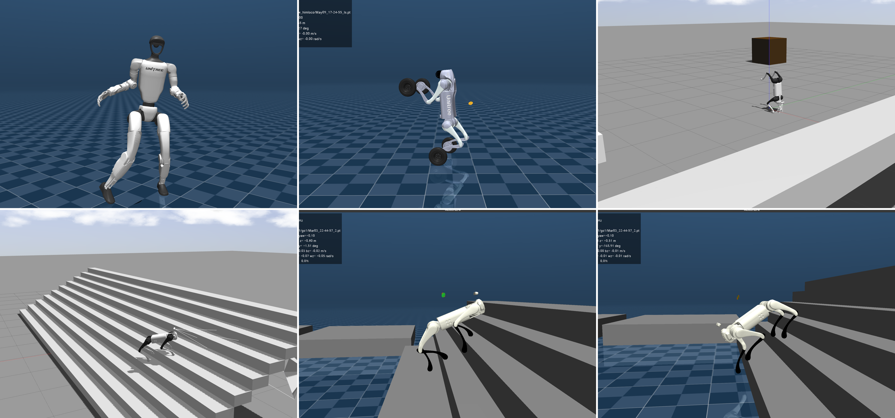

<div align="center">
  <h1 align="center">LeggedSkillDeploy</h1>
  <h3 align="center">WMP Parkour</h3>
  <p align="center">
    <a href="README.md">🌎 English</a> | <span>🇨🇳 中文</span>
  </p>
</div>

<p align="center">
  
</p>

<p align="center">
  Go1 WMP 视觉跑酷部署，支持盲走策略与视觉策略切换。
</p>

<p align="center">
  <a href="https://www.bilibili.com/video/BV1fHut6PE1j">
    
  </a>
</p>

## WMP Go1 视觉跑酷

- 本分支新增 `go1wmp` 策略，以深度图作为视觉输入，用于 Go1 WMP 跑酷部署。
- 控制方式与主分支一致，支持键盘、Xbox 手柄和手机 Web 控制。
- 使用策略切换按键，可在盲走策略与 `go1wmp` 视觉策略之间切换。
- 完整策略列表和按键说明见 [主分支 README](https://github.com/haozhang04/LeggedSkillDeploy/blob/main/README.md)。
- WMP 训练代码见 [haozhang04/wmp_go1](https://github.com/haozhang04/wmp_go1.git)。

| 文件 | 说明 |
|------|------|
| [`go1_visual_embedding.py`](go1_visual_embedding.py) | 采集并预处理 RealSense 深度图，发布原始深度图与 64×64 网络输入。 |
| [`go1_view_realsense_depth.py`](go1_view_realsense_depth.py) | 显示和录制原始深度图和网络输入图像。 |
| [`test/go1_wmp_parkour_4k.py`](test/go1_wmp_parkour_4k.py) | 无窗口运行 WMP 跑酷仿真，并录制带深度图的 4K 视频。 |

---

## 1. 创建虚拟环境

使用以下命令创建并激活 conda 虚拟环境：

```bash
conda create -n lsd python=3.10
conda activate lsd
```

---

## 2. 快速开始

### 2.1 克隆 LeggedSkillDeploy

通过 Git 克隆仓库：

```bash
git clone -b wmp_parkour https://github.com/haozhang04/LeggedSkillDeploy.git wmp_parkour
```

### 2.2 安装依赖

进入项目目录并安装依赖。此过程可能需要一些时间：

```bash
cd wmp_parkour
pip install -r requirements.txt
```

### 2.3 运行仿真

#### 2.3.1 MuJoCo

```bash
python src/rl_mujoco.py
```

#### 2.3.2 MuJoCo GLFW

```bash
python src/rl_mujoco_glfw.py
```

#### 2.3.3 Gazebo

需要先编译 ROS 2 工作空间：

```bash
cd robot_description/urdf && colcon build && cd ../..
```

然后：

```bash
python src/rl_gazebo.py
```

---

## 3. 实机操作说明

> [!WARNING]
> 当前仅在 **Go1 Pro** 实机上完成测试。实机部署存在设备损坏风险，请在充分保护的条件下操作。

RealSense 安装与服务配置见 [RealSense 相机部署说明](REALSENSE_CAMERA_DEPLOYMENT.md)。

### 3.1 在 Go1 Pro 实机运行策略

- 使用网线连接 Go1 Pro 与电脑。
- Go1 Pro 机载电脑 IP 为 `192.168.123.161`；请将电脑 IP 设置为 `192.168.123.12`，子网掩码设置为 `255.255.255.0`。
- 确认可以正常连通：

```bash
ping 192.168.123.161
```

- 在遥控器上依次执行以下组合键，进入调试模式：

```bash
L2 + A
L2 + A
L2 + B
L1 + L2 + START
```

- 视觉策略依赖 RealSense 深度图。请先在终端 1 中加载 ROS 2 环境并启动深度图发布器：

```bash
python3 go1_visual_embedding.py
```

- 保持深度图发布器运行，然后在终端 2 中启动实机部署程序：

```bash
python3 src/rl_real_go1.py
```

- 如需检查原始深度图和策略使用的 64×64 网络输入，可在终端 3 中启动（可选）：

```bash
python3 go1_view_realsense_depth.py
```

### 3.2 适配你的机器人

- 修改 `src/interface/IOReal_go1.py`，完成对应机器人的接口适配。

---

**如果这个项目对你有帮助，请给我点个 Star ⭐！**
